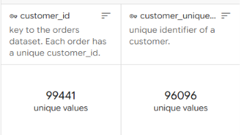
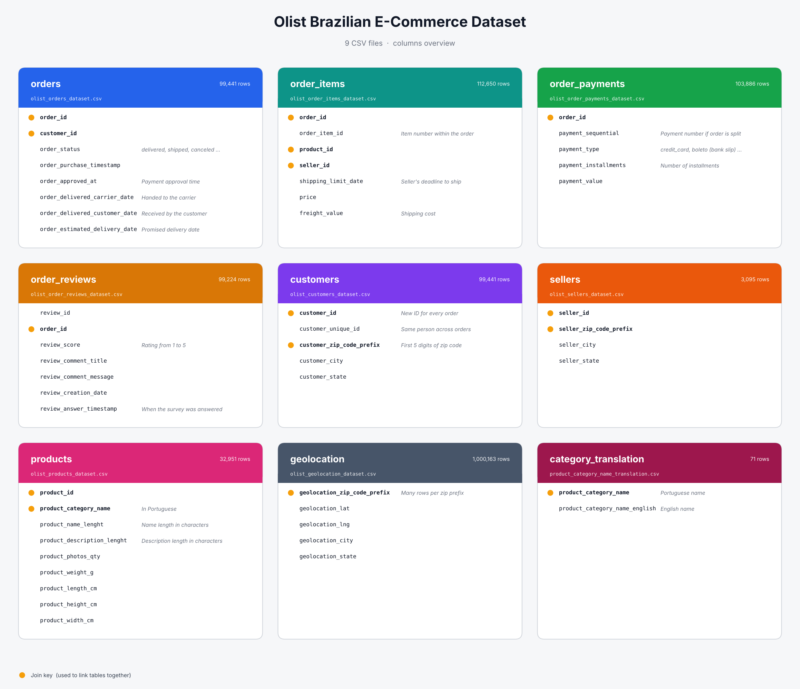

# E-Commerce-Customer-Value-and-Purchase-Prediction-
An end-to-end data analytics and machine learning project focused on analyzing e-commerce customer behavior, identifying purchasing patterns, evaluating customer value, and predicting future purchase outcomes using SQL, Python, and Machine Learning.

## 1. Problem Statement

Olist is a Brazilian online marketplace that connects small sellers with customers. Between 2016 and 2018, the platform recorded approximately 100,000 orders across multiple product categories, sellers, and regions.

Despite its growing customer base, approximately 96.9% of observed customers made only one purchase during the available data period. This indicates a significant customer retention challenge, while the business lacks a unified analytical framework to understand repeat purchasing behavior and identify customers with a higher likelihood of returning.

This project aims to build a database-backed analytics and machine learning solution to analyze sales, customer purchasing behavior, and delivery performance, identify factors associated with repeat purchases, and predict whether a first-time customer will place another order within a defined time window.

The resulting insights and predictions will help the business better understand customer retention patterns, identify valuable customer segments, and develop more targeted retention strategies.

  

## 2. Project Objectives

1. **Database Design & Development:** Design a normalized relational database covering Customers, Orders, Order Items, Products, Categories, Sellers, and Payments, with appropriate primary and foreign keys. Load the CSV datasets using Python.

2. **Business Analysis:** Analyze revenue, average order value, repeat-purchase rates, product performance, and time between orders.

3. **Data Preparation & Feature Engineering:** Extract data into Pandas, clean and transform it, handle missing values and outliers, and engineer customer features using first-order information only.

4. **Exploratory Data Analysis (EDA):** Perform exploratory and correlation analysis to identify factors associated with repeat purchases.

5. **Predictive Modeling:** Train and compare classification models against a baseline to predict 90-day repeat purchases and identify the most important factors influencing customer retention.

6. **Interactive Dashboard:** Build an interactive dashboard covering revenue, customer behavior, product performance, customer segments, and model predictions.

## 3. Business Questions

This project aims to answer five key business questions:

1. **Customer Retention:** What percentage of customers make repeat purchases, and how long does it take them to place a second order?

2. **Revenue Performance:** Which product categories, states, and payment methods generate the highest revenue?

3. **Customer Purchasing Behavior:** How do order value and payment preferences differ between one-time and repeat customers, and which customer segments are most valuable?

4. **Customer Experience:** How do delivery delays and review scores relate to the likelihood of repeat purchases?

5. **Predictive Analysis:** Which first-order features best predict a second purchase, and how accurately can the model identify potential repeat customers?

## 4. Dataset

**Brazilian E-Commerce Public Dataset by Olist**

- **Source:** [Kaggle – Brazilian E-Commerce Dataset](https://www.kaggle.com/datasets/olistbr/brazilian-ecommerce)
- **Period:** 2016–2018
- **Format:** 9 CSV files
- **Total Columns:** 52

**Note:** Yellow dots indicate join keys (columns used to link tables together).
